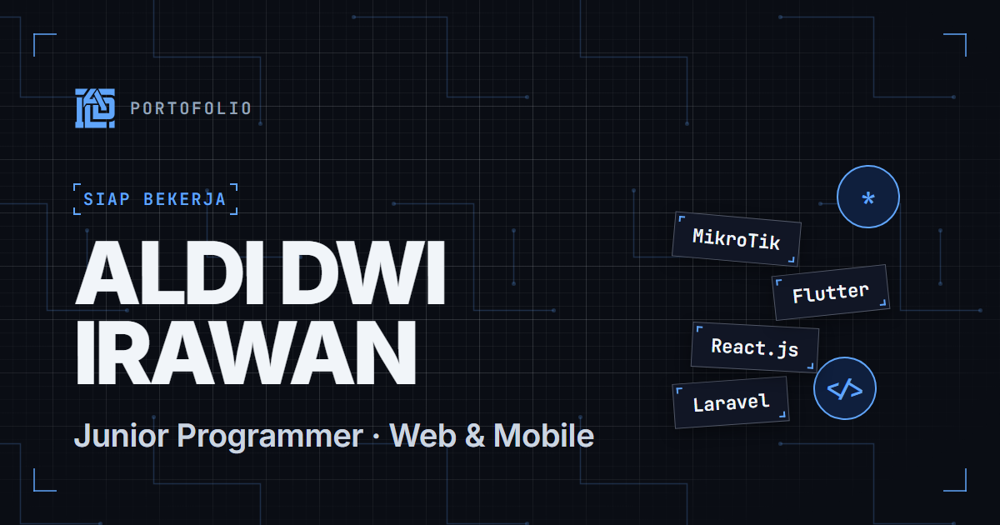

# 🌐 Aldi Dwi Irawan — Personal Portfolio & Admin CMS


> Personal portfolio website built with **React 19**, **Vite 8**, and **Supabase**, with a private **admin panel** that manages all of its content without touching the code. Bilingual (Indonesian/English), dark and light themes, project case studies, a guestbook, and live GitHub data through **Vercel** serverless functions.

🔗 **Live site:** [aldidwiirawan.vercel.app](https://aldidwiirawan.vercel.app)

---

## 📌 Project Overview

The site has two parts:

- **Public site** (`/`, `/projects/:slug`) — profile, projects presented as case studies, skills, track record, contact, and a guestbook.
- **Admin panel** (`/admin`, sign in at `/admin/login`) — a single admin account that manages every piece of content: profile, projects, skills, experience, education, organizations, certifications, achievements, languages, guestbook entries, and contact messages.

The "Blueprint" design system and all design decisions are documented in `design-system/aldi-portfolio/` (`BRIEF.md`, `MASTER.md`, `pages/*.md`, and phase plans in `plans/`).

---

## 🚀 Key Features

- **Content managed from the admin panel** — no code changes needed to update the portfolio.
- **Bilingual content** — Indonesian and English, with dedicated `*_en` columns in the database.
- **Dark and light themes.**
- **Project case studies** — each project has its own detail page with multiple links and a gallery.
- **GitHub integration** — a contribution calendar and a per-project repository panel (languages and frameworks), served by Vercel functions so the token stays on the server.
- **Guestbook** — visitors can leave messages, moderated from the admin panel.
- **Privacy by design** — public pages only read rows with `is_visible = true` and explicitly listed columns; phone numbers and full addresses are never fetched.
- **SEO** — canonical URLs, link previews (`og-image.png`), `robots.txt`, and `sitemap.xml` generated at build time.
- **Interactive details** — physics-based hero labels (matter-js, lazy-loaded), viewfinder cursor, and blueprint background.

---

## 🛠️ Technology Stack

| Component | Technology | Purpose |
| :--- | :--- | :--- |
| **Frontend** | [React 19](https://react.dev/), [react-router-dom 7](https://reactrouter.com/) | Public site and admin panel |
| **Build Tool** | [Vite 8](https://vite.dev/) | Development server and production build |
| **Styling** | Plain CSS with CSS variables | No Tailwind or UI framework |
| **Backend** | [Supabase](https://supabase.com/) | Database, Auth (admin), and Storage (`portfolio-assets` bucket) |
| **Serverless** | Vercel Functions (`api/`) | GitHub contribution calendar and repository panel |
| **Fonts** | Inter, JetBrains Mono, Space Grotesk (self-hosted via Fontsource) | Typography |
| **Physics** | matter-js (loaded separately) | Hero label animation |
| **Linting** | oxlint | Code checks |
| **Hosting** | [Vercel](https://vercel.com/) | Deployment |

---

## 🌐 System Architecture

```text
                ┌───────────────────────────────┐
 Visitor ─────► │  Public site (React + Vite)   │ ── REST (publishable key) ──┐
                └───────────────────────────────┘                             ▼
                ┌───────────────────────────────┐                   ┌───────────────────┐
 Admin ───────► │  Admin panel (/admin)         │ ── Supabase Auth ►│     Supabase      │
                └───────────────────────────────┘                   │ DB · Auth · Storage│
                                                                    └───────────────────┘
                ┌───────────────────────────────┐
 Public site ─► │ Vercel functions (api/)        │ ── GITHUB_TOKEN (server only) ──► GitHub API
                └───────────────────────────────┘
```

---

## 📁 Project Structure

```text
api/
├── github-contributions.js   # Vercel function: GitHub contribution calendar (token stays on the server)
└── github-repo.js            # Vercel function: repository panel on project pages (public repos only)
public/                       # Logo, icons, og-image.png (link preview), project cover images
src/
├── main.jsx, App.jsx         # Entry point and routes (admin is code-split: AdminShell, AdminPage)
├── components/public/        # Public sections (hero, sections, guestbook, characters, robot, SEO)
├── components/admin/         # Admin layout and components
├── components/brand, effects/# Logo, robot, viewfinder cursor, blueprint background, transitions
├── pages/                    # Public pages (home, project detail, 404) and pages/admin/*
├── hooks/                    # usePublicPortfolio, usePublicGuestbook (public); other use* hooks for admin
├── lib/                      # publicApi.js (public REST), supabaseClient.js + authService.js (admin),
│                             # image compression, PDF checks, etc.
└── i18n/                     # Indonesian/English dictionaries and character lines
supabase/migrations/          # Database changes (run manually, in order)
supabase/seed/                # Initial content from the CV and English translation drafts
design-system/aldi-portfolio/ # Brief, design system, page overrides, phase plans, og-image source
vercel.json, DEPLOY.md        # Vercel settings and deployment guide
```

### Database migrations

The files in `supabase/migrations/` record database changes since 28 September 2026. Run them **in order** in the Supabase SQL Editor. Files from phase 2B (16 October) onward are wrapped in `BEGIN … COMMIT`, are safe to re-run, and end with a verification query.

| File | Contents |
| :--- | :--- |
| `20260928000000_storage_portfolio_assets.sql` | `portfolio-assets` bucket and its policies |
| `20261008000000_cv_builder_extensions.sql` | Additional portfolio content columns |
| `20261008010000_guestbook_schema.sql` | Guestbook table |
| `20261016000000_admin_content_model.sql` | Admin content model (visible/featured, ordering, etc.) |
| `20261018000000_project_links.sql` | `projects.links` (multiple links per project) |
| `20261019000000_english_content.sql` | English columns (`*_en`) and `profiles.hero_labels` |

`supabase/seed/` is not a migration: `isi-awal-dari-cv.sql` adds content from the CV (rows whose names already exist are skipped), and `terjemahan-en.sql` fills the `_en` columns (rows whose Indonesian text has changed are skipped).

---

## ⚙️ Installation & Setup

### Prerequisites
- Node.js **20.19+ or 22.12+** (required by Vite 8)
- A Supabase project

### Steps
```bash
git clone https://github.com/Aldidwiirawan/portofolio.git
cd portofolio
npm install
```

Create `.env.local` in the project root (see below), then run the SQL files in `supabase/migrations/` in order.

---

## 🔐 Environment Variables

| Variable | Where | Description |
| :--- | :--- | :--- |
| `VITE_SUPABASE_URL` | `.env.local` and Vercel | Supabase project URL |
| `VITE_SUPABASE_PUBLISHABLE_KEY` | `.env.local` and Vercel | Supabase **publishable** key — never use the `service_role`/secret key |
| `VITE_SITE_URL` | Vercel (optional locally) | Site URL without a trailing `/`; used for canonical URLs, link previews, and the sitemap |
| `GITHUB_TOKEN` | Vercel only | Read by the GitHub functions on the server; **never** prefix it with `VITE_` |

Without `VITE_SITE_URL`, the build does not generate `sitemap.xml` or canonical URLs. The GitHub contribution chart only appears once deployed on Vercel with `GITHUB_TOKEN`; it does not show in `npm run dev`.

---

## ▶️ How to Run

| Command | Description |
| :--- | :--- |
| `npm run dev` | Development server at `http://localhost:5173` |
| `npm run build` | Production build to `dist/` (also generates `robots.txt`, `sitemap.xml`, and checks CSP hashes) |
| `npm run preview` | Serve the production build |
| `npm run lint` | Code checks (oxlint) |

### Deployment
The full step-by-step guide (in Indonesian) is in **[DEPLOY.md](DEPLOY.md)**: importing the repo, environment variables, the GitHub token, Supabase Auth, the post-deploy checklist, redeploying for the sitemap, custom domains, and CSP notes.

---

## 🖼️ Preview



---

## 👨‍💻 Author

**Aldi Dwi Irawan** — Junior Programmer (Web & Mobile)
- GitHub: [@Aldidwiirawan](https://github.com/Aldidwiirawan)
- Portfolio: [aldidwiirawan.vercel.app](https://aldidwiirawan.vercel.app)
- Email: aldidwiirawan2004@gmail.com
